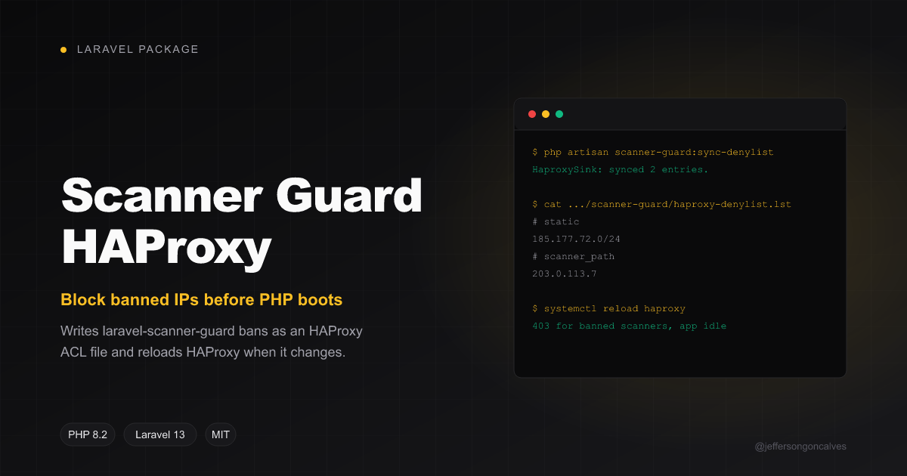

<div class="filament-hidden">



</div>

# Laravel Scanner Guard HAProxy

[](https://packagist.org/packages/jeffersongoncalves/laravel-scanner-guard-haproxy)
[](https://github.com/jeffersongoncalves/laravel-scanner-guard-haproxy/actions/workflows/tests.yml)
[](https://packagist.org/packages/jeffersongoncalves/laravel-scanner-guard-haproxy)

HAProxy denylist sink for [`laravel-scanner-guard`](https://github.com/jeffersongoncalves/laravel-scanner-guard).
Writes every banned IP and `ip_blocklist` entry to an HAProxy ACL file, so banned scanners get a `403`
from HAProxy before they reach your app servers. Tested on HAProxy 3.x; older versions work with the
note on `opt@` below.

```
# static
185.177.72.0/24
# scanner_path, expires 2026-11-20T10:00:00+00:00
203.0.113.7
```

## Installation

```bash
composer require jeffersongoncalves/laravel-scanner-guard-haproxy
```

Add the sink to `config/scanner-guard.php`:

```php
'sinks' => [
    \JeffersonGoncalves\ScannerGuardHaproxy\HaproxySink::class,
],
```

Deny the file's addresses **first** in your frontend:

```haproxy
frontend web
    bind :443 ssl crt /etc/haproxy/certs
    http-request deny if { src -f opt@/var/www/html/storage/app/scanner-guard/haproxy-denylist.lst }
    # ...
```

- Keep it above your other `http-request` rules: one that ends the request (`return`, `redirect`,
  `allow`) would let it skip the denylist.
- Keep `opt@`: HAProxy refuses to start when a plain path doesn't exist yet. It needs HAProxy 3.0; on
  older versions drop it and run `php artisan scanner-guard:sync-denylist` before HAProxy loads the
  rule.
- To close the connection without an answer, use `tcp-request connection reject if { src -f ... }`
  instead. It runs before any HTTP header is read, so it can't be combined with `set-src` below.
- HAProxy must be able to read the file, including its parent directories. It reads it before
  entering its `chroot`.

`scanner-guard:sync-denylist` now runs every minute, and right after every ban, unban and blocklist
change (see the core README's "Blocking before PHP" section).

## Configuration

```bash
php artisan vendor:publish --tag="laravel-scanner-guard-haproxy-config"
```

| Key | Env | Default | |
|---|---|---|---|
| `path` | `SCANNER_GUARD_HAPROXY_PATH` | `storage/app/scanner-guard/haproxy-denylist.lst` | relative to `base_path()` |
| `reload_command` | `SCANNER_GUARD_HAPROXY_RELOAD_COMMAND` | `null` | e.g. `sudo systemctl reload haproxy` |

The file is only rewritten when its content changes, through a temp file renamed over the target,
so HAProxy never reads a half-written list. HAProxy only re-reads an ACL file on reload: the
`reload_command` runs after a write, never otherwise. A non-zero exit or a timeout is logged, never
thrown, and every sync runs it again until it succeeds (a `.reload` file next to the list marks it).
The PHP user (and your queue worker, if different) must be allowed to run it without a password,
e.g. in `/etc/sudoers.d/scanner-guard`:

```
www-data ALL=NOPASSWD: /usr/bin/systemctl reload haproxy
```

In a container, HAProxy runs in master-worker mode and reloads on `SIGUSR2` to the master. Where PHP
can't send it, leave the command empty and let another process send it when the file's mtime changes.

A connection that is already open stays on the old list until it closes. `hard-stop-after` in the
`global` section limits how long.

HAProxy must run on the machine where the app writes the file, or share that directory.

### Behind a proxy or CDN

`src` is the connecting address. Behind Cloudflare or another load balancer, that is the proxy's IP
unless you restore the client IP first, trusting only the proxy's ranges:

```haproxy
    acl from_cloudflare src -f /etc/haproxy/cloudflare-ips.lst
    http-request set-src hdr(CF-Connecting-IP) if from_cloudflare
    http-request deny if { src -f opt@/var/www/html/storage/app/scanner-guard/haproxy-denylist.lst }
```

Otherwise the denylist never matches a visitor. The same applies to the app behind HAProxy: forward
the client IP (`option forwardfor`) and trust HAProxy in `TrustProxies`, or scanner-guard bans
HAProxy itself.

## Testing

```bash
composer test
```

## Changelog

Please see [CHANGELOG](CHANGELOG.md) for more information on what has changed recently.

## Credits

- [Jefferson Gonçalves](https://github.com/jeffersongoncalves)
- [All Contributors](../../contributors)

## License

The MIT License (MIT). Please see [License File](LICENSE.md) for more information.
